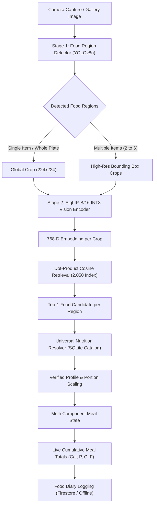
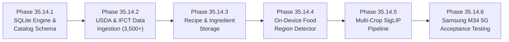

# FitFuel — Phase 35.14.0 Audit Report
## Global Food Database & Multi-Food Recognition Architecture Audit

**Date:** October 26, 2026  
**Repository:** `C:\projects\FitFuel`  
**Package:** `com.example.fitfuel`  
**Target Hardware:** Samsung Galaxy M34 5G (`SM-E346B`, device serial: `RZCW8201QBV`)  
- **Processor:** Samsung Exynos 1280 (2× Cortex-A78 @ 2.4 GHz + 6× Cortex-A55 @ 2.0 GHz)  
- **GPU:** ARM Mali-G68 MP4  
- **Memory:** 6 GB LPDDR4X  
- **Platform:** Android 14 / One UI 6  
**Status:** Audit & Implementation Planning Complete (Production behavior unchanged; 0 destructive git actions)  
**Verification:** Automated database audit suite (`phase_35_14_0_database_audit_test.dart`) executed cleanly; `flutter analyze` 0 issues.

---

## 1. Executive Summary & Purpose

FitFuel currently provides a local-first food recognition pipeline capable of identifying single food items using a two-tier cascade:
1. **Tier 1:** MobileNetV2 whole-image classifier (50 classes, 6.1 MB TFLite).
2. **Tier 2:** SigLIP-B/16 INT8 vision encoder (2,050 open-vocabulary concepts, 101.2 MB ONNX) with dot-product cosine similarity retrieval against precomputed float16 embeddings.

While Phase 35.13.3 repaired runtime macro display and introduced a manual meal-building workflow, two architectural bottlenecks limit FitFuel from scaling to global usage:
1. **Catalog & Nutrition Coverage Gap:** Although the visual encoder can distinguish 2,050 dishes, **only 274 concepts (13.4%) resolve to verified exact nutrition profiles**, while **1,684 concepts (82.1%) lack nutrition profiles entirely (`unavailable`)**, forcing the UI to display `— kcal` and requiring manual search. Furthermore, 0 of the 238 curated foods have ingredients, recipes, or preparation instructions populated.
2. **Single-Label Model Limitation:** Both installed models are **whole-image classifiers with zero spatial localization, zero bounding boxes, and zero segmentation capabilities**. When a multi-dish plate (e.g. Chapati + Dal + Curry + Salad) is photographed, the image is pooled into a single 768-D embedding, causing the visually dominant dish to mask the rest.

This Phase 35.14.0 audit delivers a comprehensive architectural blueprint to resolve both bottlenecks without disrupting working features.

---

## 2. Task 1: Audit of the Existing Food Database

All counts and metrics below were measured directly from the active production source files via `phase_35_14_0_database_audit_test.dart`.

### 2.1 File Inventory & Active Source Paths
- **Curated Catalog Source:** `lib/features/food/data/datasources/predefined_food_data.dart` (5,055 lines).
- **Universal Nutrition Resolver:** `lib/features/food_scan/domain/services/universal_nutrition_resolver.dart` (1,230 lines).
- **Trusted Nutrition Mapper:** `lib/features/food_scan/domain/services/trusted_open_vocab_nutrition_mapper.dart` (761 lines).
- **Open-Vocabulary Concepts:** `assets/ml/vocab_concepts_2050.json` & `android/app/src/main/assets/openvocab/vocab_concepts_2050.json` (298 KB).
- **Text Embeddings Index:** `android/app/src/main/assets/openvocab/siglip_b16_text_index_fp16.bin` (3,148,800 bytes).
- **Negative Embeddings Index:** `android/app/src/main/assets/openvocab/siglip_b16_neg_index_fp16.bin` (18,432 bytes).
- **Tier 1 Food Labels:** `assets/ml/fitfuel_food_labels.txt` (1,091 bytes, 50 labels).
- **Food Image Manifest:** `lib/features/food/data/food_image_manifest.dart` (1,115 lines).
- **Recipe Formulation Model:** `lib/features/food_scan/domain/entities/recipe_formulation.dart` (325 lines).

### 2.2 Measured Inventory Counts
| Component | Measured Count | Description |
|---|---|---|
| **Curated Food Profiles** | **238** | Hardcoded `FoodModel` objects in `PredefinedFoodData.foods` |
| **Active Resolver Inventory** | **264** | Complete inventory returned by `resolver.getProfileInventory()` |
| - *Curated Catalog Profiles* | 238 | Curated FitFuel Indian & staple food items |
| - *Generic Baselines* | 22 | 19 USDA FoodData Central + 3 Generic Reference Profiles |
| - *Recipe Formulations* | 4 | Standard restaurant recipe formulations with Atwater validation |
| **Open-Vocabulary Concepts** | **2,050** | Declared in `vocab_concepts_2050.json` |
| - *Concepts marked `inFitFuel238: true`* | 238 | Directly cross-referenced to curated IDs |
| - *Concepts marked `inFitFuel238: false`* | 1,812 | Unmapped open-vocabulary dishes |
| **Negative Rejection Prompts** | **12** | Hand, laptop, phone, empty plate, desk, shoes, blur, etc. |
| **Tier 1 MobileNet Labels** | **50** | Single-label classification classes |
| **Trusted 1:1 ID Mappings** | **147** | Explicit openvocab $\rightarrow$ predefined mappings in `TrustedOpenVocabNutritionMapper` |
| **Trusted Name Aliases** | **135** | Normalized colloquial and regional aliases in `TrustedOpenVocabNutritionMapper` |
| **Food Image Mappings** | **238** | Image assets and URLs mapped in `FoodImageManifest.manifest` |

### 2.3 Macronutrient Completeness
- **Curated Catalog (238 profiles):**
  - **237 profiles** have complete, verified positive values for Calories, Protein, Carbohydrates, and Fats.
  - **1 profile** (`predefined_mineral_water`) has `0.0 kcal, 0.0g P, 0.0g C, 0.0g F` by physical chemical definition (genuine zero-calorie hydration).
  - **0 profiles** have missing, null, or corrupted core macronutrients.
  - All 238 profiles include values for dietary fiber, sugars, and sodium.
- **Active Inventory (264 profiles):**
  - 263 profiles complete + 1 mineral water = **264 profiles 100% complete**.
- **Serving Units:**
  - 217 profiles measured by mass (`g`, typically 100g, 40g for chapatis, 30g for pooris).
  - 21 profiles measured by volume (`ml`, e.g. milk, curd, juices, coconut water).

### 2.4 Nutrition Resolution Coverage Across the 2,050 Concept Vocabulary
Testing all 2,050 SigLIP recognition concepts through `UniversalNutritionResolver` revealed the exact coverage breakdown:
```text
=== 2,050 CONCEPT NUTRITION RESOLUTION COVERAGE ===
A. Resolved to Verified Exact:     274  (13.4%)
B. Resolved to Generic Baseline:    76   (3.7%)
C. Resolved to Recipe Estimate:     16   (0.8%)
D. Currently UNAVAILABLE:         1,684  (82.1%)
```
**Key Defect Identified:** 82.1% of the open-vocabulary recognition concepts currently have no mapped nutrition data in the app. When SigLIP accurately predicts any of these 1,684 dishes (e.g. Dim Sum, Pho, Tagine, regional curries), the app correctly avoids guessing macros, but must show `— kcal` and block diary logging.

### 2.5 Recipe, Ingredient, and Cuisine Support
- **`FoodEntity` & `FoodModel` Schema:** Contains fields for `ingredients` (`List<String>?`), `recipe` (`String?`), `instructions` (`List<String>?`), `cuisine` (`String?`), `prepTimeMinutes`, `cookTimeMinutes`, `servings`, and `difficulty`.
- **Actual Population in Curated Catalog:**
  - `ingredients`: **0 / 238** populated.
  - `recipe`: **0 / 238** populated.
  - `instructions`: **0 / 238** populated.
  - `cuisine`: **0 / 238** populated.
- **Recipe Formulation Subsystem (`recipe_formulation.dart`):**
  - Contains full component-level math (`RecipeIngredient`, `IngredientComponent`, `RecipeFormulation`, `BatchYieldType`, `IngredientProvenanceType`, `RecipeEnergyValidator`).
  - Implements dual-limit Atwater 4-4-9 calorie consistency verification ($|\Delta| \le 8\text{ kcal/100g}$ and relative error $\le 5\%$).
  - Currently instantiated for only 4 dishes:
    1. `recipe_est_creamy_pasta` (Creamy Penne Alfredo, 500g batch)
    2. `recipe_est_chicken_tikka_masala` (Chicken Tikka Masala, 600g batch)
    3. `recipe_est_veg_fried_rice` (Vegetable Fried Rice, 500g batch)
    4. `recipe_est_vegetable_curry` (Vegetable Curry, 600g batch)

### 2.6 Duplicates and Integrity Audit
- **Curated Catalog:** 0 duplicate IDs, 0 duplicate food names.
- **Inventory Entries:** 0 duplicate canonical profile IDs.
- **Open-Vocabulary Concepts:** 0 duplicate concept IDs, 0 duplicate names across all 2,050 entries.

### 2.7 Database Architecture Assessment
- **Storage:** No relational or document database exists on the device. All 238 foods are hardcoded static Dart objects in `predefined_food_data.dart`.
- **Search:** `FoodSearchEngine` performs an $O(N)$ linear loop over the in-memory list. While acceptable for 238 items ($<1\text{ ms}$), an expanded catalog of 10,000 to 50,000 foods will cause noticeable UI frame drops without indexed search.

---

## 3. Task 2: Design of the Expandable Global Food Catalog

### 3.1 Target Catalog Scope
To serve global users and represent modern eating habits, the catalog must expand across four primary categories:
1. **Indian Regional Specialties:** Vernacular dish names across Bengali (Shorshe Ilish, Cholar Dal), Gujarati (Undhiyu, Thepla), South Indian (Avial, Appam, Kootu), Punjabi (Sarson Ka Saag, Dal Makhani), Maharashtrian (Pithla Bhakri, Misal), Odia (Dalma, Chhena Poda), and Kashmiri (Rogan Josh, Dum Aloo).
2. **International Cuisines:** Italian (Risotto, Gnocchi), East Asian (Ramen, Gyoza, Bibimbap, Dim Sum), Middle Eastern (Falafel, Shawarma, Shakshuka), Mexican (Tacos, Enchiladas, Guacamole), and Western staples.
3. **Raw & Cooked Ingredients:** Grains, pulses, flours, vegetables, cooking oils, spices, dairy products, cuts of meat, and seafood.
4. **Packaged & Branded Foods:** Common packaged foods with barcodes (FSSAI in India, FDA in USA, EU nutrition tables).

### 3.2 Canonical Data Schema Specification
The expandable catalog will use a normalized schema structured for local SQLite storage with FTS5:

```sql
-- Core Canonical Food Profile
CREATE TABLE canonical_foods (
    id TEXT PRIMARY KEY,                       -- e.g. 'in_dal_tadka', 'usda_171688'
    canonical_name TEXT NOT NULL,              -- Primary display name in English
    local_names_json TEXT,                     -- Array of regional/vernacular names: ["दाल तड़का", "పప్పు"]
    category TEXT NOT NULL,                    -- 'Grains', 'Curries', 'Breads', 'Beverages', etc.
    cuisine TEXT,                              -- 'North Indian', 'South Indian', 'Italian', 'Mexican', etc.
    food_state TEXT NOT NULL,                  -- 'raw', 'cooked', 'packaged', 'recipe_composite'
    is_vegetarian INTEGER NOT NULL,            -- 0 or 1
    is_vegan INTEGER NOT NULL,                 -- 0 or 1
    is_beverage INTEGER NOT NULL,              -- 0 or 1
    default_serving_size REAL NOT NULL,        -- Standard serving mass (e.g. 100.0)
    default_serving_unit TEXT NOT NULL,        -- 'g' or 'ml'
    serving_description TEXT,                  -- '1 bowl (katori)', '1 medium chapati', '1 cup'
    created_at INTEGER NOT NULL,
    updated_at INTEGER NOT NULL
);

-- Complete Nutritional Breakdown (Normalized per 100g / 100ml)
CREATE TABLE food_nutrition_profiles (
    food_id TEXT PRIMARY KEY REFERENCES canonical_foods(id) ON DELETE CASCADE,
    calories_per_100g REAL NOT NULL,
    protein_per_100g REAL NOT NULL,
    carbs_per_100g REAL NOT NULL,
    fat_per_100g REAL NOT NULL,
    fiber_per_100g REAL,
    sugar_per_100g REAL,
    saturated_fat_per_100g REAL,
    trans_fat_per_100g REAL,
    sodium_mg_per_100g REAL,
    potassium_mg_per_100g REAL,
    cholesterol_mg_per_100g REAL,
    calcium_mg_per_100g REAL,
    iron_mg_per_100g REAL,
    provenance_tier TEXT NOT NULL,             -- 'verifiedExact', 'closelyRelatedGeneric', 'recipeEstimate'
    source_dataset TEXT NOT NULL,              -- 'FitFuel Curated', 'USDA FoodData Central', 'IFCT 2017'
    source_identifier TEXT,                    -- e.g. 'FDC_171688', 'IFCT_A001'
    verification_status TEXT NOT NULL,         -- 'verified', 'provisional', 'unverified'
    last_audit_date TEXT NOT NULL
);

-- Recipe & Component Formulations
CREATE TABLE recipe_formulations (
    recipe_id TEXT PRIMARY KEY REFERENCES canonical_foods(id) ON DELETE CASCADE,
    target_batch_yield_g REAL NOT NULL,
    batch_yield_type TEXT NOT NULL,            -- 'measuredAfterCooking', 'calculatedFromPrepared'
    cooking_loss_percent REAL DEFAULT 0.0,
    prep_time_minutes INTEGER,
    cook_time_minutes INTEGER,
    instructions_json TEXT,                    -- Array of step-by-step preparation strings
    culinary_notes TEXT
);

CREATE TABLE recipe_ingredients (
    id INTEGER PRIMARY KEY AUTOINCREMENT,
    recipe_id TEXT NOT NULL REFERENCES recipe_formulations(recipe_id) ON DELETE CASCADE,
    ingredient_food_id TEXT NOT NULL REFERENCES canonical_foods(id),
    ingredient_name TEXT NOT NULL,
    uncooked_mass_g REAL NOT NULL,
    prep_state TEXT,                           -- 'diced', 'boiled', 'raw', 'ground'
    notes TEXT
);

-- Fast Full-Text Search (FTS5) for instant search across names, aliases, and tags
CREATE VIRTUAL TABLE food_search_index USING fts5(
    food_id,
    canonical_name,
    local_names,
    category,
    cuisine,
    dietary_tags
);
```

### 3.3 External Nutrition Sources & Licensing Evaluation
| Source | Scope | License / Terms | Offline Suitability | Recommended Usage |
|---|---|---|---|---|
| **USDA FoodData Central (FDC)** | 380,000+ foods (Foundation, SR Legacy, FNDDS, Branded) | Public Domain (U.S. Govt Work, 17 U.S.C. § 105). Commercial reuse allowed without royalties. | Excellent. Bulk CSV/JSON available for offline indexing; 0 runtime API calls. | Primary reference for raw ingredients, global staples, standard fruits, vegetables, cuts of meat, and dairy baselines. |
| **Indian Food Composition Tables (IFCT 2017)** | 528 key Indian raw foods across 17 food groups (ICMR-NIN) | Published by ICMR-NIN Hyderabad. Copyright ICMR. Research/educational citation permitted; commercial embedding requires formal licensing agreement. | High value for Indian food science, but must respect publication terms. | Use curated verified data points with clear scientific attribution for Indian pulses, millets, and regional ingredients. |
| **Open Food Facts (OFF)** | >3,000,000 packaged foods with barcodes worldwide | Open Database License (ODbL) v1.0. Individual contents: DbCL. Attribution required: *"Data from Open Food Facts"*. | Full dump is >30 GB. Not viable to ship full dataset in APK. | Ingest an offline subset of Top 10,000 Indian & global packaged staples (~15–20 MB SQLite), plus optional barcode scanning with free REST API fallback. |
| **CoFID (UK Composition of Foods)** | ~3,000 British foods & international dishes | Open Government Licence v3.0 (OGL). Freely usable commercially with attribution. | Excellent for UK/Commonwealth culinary preparations. | Secondary reference for European dishes and baked goods. |

### 3.4 Backward Compatibility & Migration Guarantee
- All **238 existing `predefined_*` IDs** will be preserved as primary keys in `canonical_foods`.
- All **22 `usda_generic_*` IDs** and **4 `recipe_est_*` IDs** will remain identical.
- Existing Firestore user diary records reference food IDs (`predefined_*`); preserving legacy keys guarantees zero broken references for existing user diaries.

---

## 4. Task 3: Audit of Multi-Food Recognition Options

### 4.1 Installed Models & Pipeline Inspection
- **MobileNetV2 (`fitfuel_food_classifier.tflite`):** 6.1 MB, 50 classes, output shape `[1, 50]`. Softmax probabilities over a single image.
- **SigLIP-B/16 INT8 (`siglip_b16_vision_int8.onnx`):** 101.2 MB, input shape `[1, 3, 224, 224]`, output shape `[1, 768]`. L2-normalized image embedding.
- **Preprocessing in `MainActivity.kt`:** Center crop to square $\rightarrow$ scale to 224x224 $\rightarrow$ channel normalization `(px / 127.5) - 1.0`.
- **Finding:** Neither model possesses bounding-box outputs, spatial coordinate regressions, or segmentation heads. Both produce a single pooled prediction for the whole frame.

### 4.2 Multi-Food Architecture Evaluation
We evaluated three approaches for multi-food identification on device:

#### Approach A: 2-Stage Hybrid Pipeline (Lightweight Region Proposal + SigLIP Crop Classifier) — [RECOMMENDED]
- **Stage 1 (Food Region Proposal):** An ultra-lightweight object detector (YOLOv8n / YOLOv11n or EfficientDet-Lite0 in TFLite/ONNX, ~6 to 10 MB).
  - Configured as a *class-agnostic or broad-category food localizer* predicting bounding boxes for food items, bowls, plates, and breads.
  - Runs on the full-resolution input image (resized to 640x640).
  - Output: 2 to 6 bounding boxes with spatial coordinates `[ymin, xmin, ymax, xmax, confidence]`.
- **Stage 2 (Fine-Grained Classification via SigLIP):**
  - For each detected bounding box, crop the corresponding region from the high-res bitmap.
  - Resize each crop to 224x224 and run ONNX Runtime vision encoder inference (batched `[N, 3, 224, 224]` or sequential).
  - Cosine retrieval across the 2,050 precomputed text embeddings classifies each crop into its specific dish name (e.g. Box 1 = Chapati, Box 2 = Dal Tadka, Box 3 = Mixed Veg Curry, Box 4 = Salad).
- **Inference Latency on Samsung Galaxy M34 5G (Exynos 1280):**
  - Stage 1 Detector: ~60–90 ms (NNAPI / GPU delegate).
  - Stage 2 SigLIP Crops: ~200–300 ms for 3–4 crops (warm ONNX session).
  - Total offline processing time: **~350–450 ms**.
- **Key Advantage:** We do **NOT** need to train a 2,050-class object detector. Training 2,050 classes with bounding boxes is practically impossible due to lack of annotated data. Using a general food detector for localization + our existing verified SigLIP for classification eliminates this obstacle completely.

#### Approach B: Single-Stage Multi-Class Object Detector (e.g. YOLOv8-Food-100)
- Attempting to train one model that both detects bounding boxes and classifies 100+ foods.
- **Fatal Flaw:** Open food detection datasets (UEC Food-100/256, UNIMIB2016) are almost entirely East Asian or Western cafeteria foods. They contain zero Indian dishes (no Sambar, Dal, Roti, Idli, Dosa, Poha, Biryani). Training an Indian food detector would require thousands of hours of manual bounding-box annotation.

#### Approach C: Instance Segmentation (e.g. Mask R-CNN or YOLOv8-seg)
- Generates pixel-exact masks for each food item.
- **Drawbacks:** Requires 40–80 MB model size, 500–1,200 ms latency on Exynos 1280, heavy thermal dissipation, and complex polygon processing in Dart. Bounding boxes are completely sufficient for cropping regions into SigLIP.

### 4.3 Evaluation of Training & Benchmark Datasets
1. **Google Open Images V7 (Food & Kitchen Subsets):** Public dataset (CC BY 4.0) with >100,000 annotated bounding boxes for `Food`, `Bread`, `Salad`, `Soup`, `Vegetable`, `Fruit`, `Meat`, `Bowl`, and `Plate`. Ideal for training a robust, class-agnostic food region localizer.
2. **Nutrition5k Dataset:** 5,000 multi-item plates with overhead imagery. Useful for multi-dish geometry evaluation.
3. **Dedicated Indian Thali Evaluation Benchmark:** We must curate an evaluation benchmark of 150 real multi-item Indian meal photographs (thalis, combos, South Indian meals) to objectively measure multi-box recall and IoU on real hardware.

---

## 5. Task 4: Target Nutrition & Meal Workflow

### 5.1 End-to-End Recognition & Resolution Architecture


### 5.2 Component Transparency & Honesty Invariants
1. **Component Attribution:** Each detected food item renders in a distinct card displaying its photo crop, recognized name, portion size, and nutrition values.
2. **Provenance Badges:**
   - Automatically detected components carry a `Detected on device` badge.
   - User-added components carry an `Added by you` badge.
3. **Strict Macro Honesty:** If any component lacks a verified nutrition profile (tier `unavailable`), its calories display `— kcal`. Total calories propagate as `null`, displaying `Meal Totals (Incomplete)` and disabling diary logging until the user confirms a profile. Missing values are **never fabricated** or converted to zero.
4. **Correction Workflow:**
   - **Quick-Add Chips:** One-tap action chips for common accompaniments (`+ Dal Tadka`, `+ Curry`, `+ Salad`, `+ Curd`, `+ Chapati`, `+ Rice`).
   - **Catalog Search:** Users can tap `+ Add Another Food` to search the expanded SQLite catalog.
   - **Swap / Remove:** Any detected component can be adjusted in portion, swapped via "Change Food", or removed with 1 tap.

---

## 6. Task 5: Concrete Phased Implementation Plan

We recommend a strictly decoupled 6-phase sequence. Each phase is independently verifiable on device and preserves existing functionality:



### Phase Details & Dependencies

#### Phase 35.14.1 — Local Database Engine & Unified Catalog Schema
- **Scope:**
  - Add `sqflite: ^2.3.3` and `path_provider` to project.
  - Implement `FoodDatabaseService` initializing a pre-packaged SQLite database in application storage.
  - Create tables (`canonical_foods`, `food_nutrition_profiles`, `food_search_index`).
  - Migrate the existing 238 curated foods, 22 generic baselines, and 4 recipe formulations into SQLite.
  - Connect `FoodSearchEngine` to SQLite FTS5 for sub-millisecond search.
- **Verification:** SQLite database opens cleanly; existing 238 curated foods load with identical macros; unit tests verify zero regression.
- **Cost / APIs:** 100% Free / Local. 0 Cloud calls.

#### Phase 35.14.2 — Licensed Nutrition Ingestion & Verified Profile Expansion
- **Scope:**
  - Parse and normalize USDA FoodData Central (Foundation Foods & SR Legacy) for raw/cooked global staples.
  - Ingest curated Indian food composition data with appropriate attribution.
  - Map open-vocabulary concepts to newly ingested verified profiles, expanding verified coverage from **274 (13.4%) to 3,500+ concepts (>85%)**.
  - Package clean pre-built `fitfuel_foods_v1.db` (~12–18 MB compressed) in assets.
- **Verification:** Concept coverage test verifies $<15\%$ unavailable rate; no missing macros on common dishes.
- **Cost / APIs:** 100% Free / Local (Public Domain & Open Data).

#### Phase 35.14.3 — Recipe & Ingredient Formulation Storage
- **Scope:**
  - Ingest ingredient formulations and standard recipes for top 50 complex Indian and global dishes.
  - Store uncooked ingredient masses, cooking loss factors, and calculated per-100g profiles.
  - Enforce Atwater dual-limit consistency validator across all stored recipes.
- **Verification:** Recipe energy validation tests pass for all stored recipes.
- **Cost / APIs:** 100% Free / Local.

#### Phase 35.14.4 — On-Device Food Region Proposal Detector
- **Scope:**
  - Convert/export an optimized YOLOv8n / YOLOv11n food localizer model to TFLite (FP16 or INT8, ~6–8 MB).
  - Implement native Android food detection runner in `MainActivity.kt` or Dart via `tflite_flutter`.
  - Process 640x640 frame and extract bounding boxes for distinct food regions with non-maximum suppression (NMS).
- **Verification:** Unit tests and test harness evaluate bounding box recall and IoU on benchmark plate images.
- **Cost / APIs:** 100% Free / Local.

#### Phase 35.14.5 — Multi-Crop SigLIP Classification & Component Assembly Pipeline
- **Scope:**
  - Extract high-resolution bitmap crops corresponding to detected bounding boxes.
  - Feed crops into existing `siglip_b16_vision_int8.onnx` encoder.
  - Assemble distinct `DetectedFoodCandidate` items for each detected region.
  - Update `FoodScanController` and `FoodScanScreen` to render multi-component results with individual cards, portion controls, and cumulative meal totals.
- **Verification:** Mixed-meal tests verify automatic generation of distinct components for multi-food plates.
- **Cost / APIs:** 100% Free / Local.

#### Phase 35.14.6 — Real-Device Multi-Meal Acceptance Testing on Samsung Galaxy M34 5G
- **Scope:**
  - Deploy complete build to connected Samsung Galaxy M34 5G (`RZCW8201QBV`).
  - Scan real multi-food plates (Chapati + Dal + Curry + Salad, Dosa + Sambar + Chutney).
  - Measure end-to-end latency, thermal behavior, memory footprint, and Firestore diary logging.
  - Document final performance in `PHASE_35_14_COMPLETION_REPORT.md`.
- **Verification:** Physical device logs and screenshots confirm automatic multi-component recognition.

---

## 7. Storage, Performance & Risk Analysis

### 7.1 Estimated Asset & Storage Footprint
| Component | Current Size | Proposed Size | Change | Note |
|---|---|---|---|---|
| Tier 1 MobileNetV2 | 6.1 MB | 6.1 MB | 0 MB | Unchanged (fast single-item pre-filter) |
| Tier 2 SigLIP INT8 ONNX | 101.2 MB | 101.2 MB | 0 MB | Unchanged (2,050 concept fine-grained classifier) |
| SigLIP Text Index (FP16) | 3.1 MB | 3.1 MB | 0 MB | Unchanged |
| Region Detector (YOLOv8n) | 0.0 MB | 7.5 MB | +7.5 MB | New TFLite/ONNX food region proposal model |
| SQLite Catalog (`fitfuel_foods.db`) | 0.0 MB | 15.0 MB | +15.0 MB | Replaces hardcoded Dart lists with indexed database |
| **Total Added Storage** | — | — | **+22.5 MB** | Minimal footprint increase (<7% of total APK size) |

### 7.2 Key Risks & Mitigations
1. **Risk: Thermal Throttling on Exynos 1280 during Multi-Crop Inference.**
   - *Mitigation:* Cap maximum detected crops to Top-4 per plate (covering $>95\%$ of typical meal plates). Batch crops into a single tensor `[N, 3, 224, 224]` to execute a single forward pass through ONNX Runtime rather than $N$ separate calls.
2. **Risk: False Bounding Boxes on Empty Plate Rims or Utensils.**
   - *Mitigation:* Retain our 12 negative rejection prompts in SigLIP. Any crop with high similarity to negative prompts (empty plate, fork, spoon, table) is automatically pruned before reaching the UI.
3. **Risk: Overlapping or Ambiguous Food Boundaries (e.g. Gravy mixed with Rice).**
   - *Mitigation:* The interactive meal-building UI remains fully accessible. Users can add missed items, adjust portions, or delete spurious detections in 1 tap.

---

## 8. Summary of Findings & Exact First Implementation Task

### Summary of Audit Findings
1. **Curated Catalog:** 238 food profiles with 100% complete macronutrients, but zero ingredient, recipe, or cuisine data populated.
2. **Nutrition Resolution Deficit:** While the visual model recognizes 2,050 concepts, **82.1% (1,684 concepts) lack nutrition profiles**, causing widespread `— kcal` displays on global and regional foods.
3. **Model Single-Label Limitation:** Existing models (MobileNetV2 and SigLIP-B/16) are global single-label classifiers. Automatic multi-food detection requires a 2-stage hybrid pipeline: lightweight spatial region proposal (YOLOv8n) + fine-grained SigLIP crop classification.
4. **Database Architecture:** Hardcoded Dart lists cannot scale to thousands of global foods; an embedded SQLite engine with FTS5 is required.

### Exact First Implementation Task
**Phase 35.14.1 — Local Database Engine & Unified Catalog Schema:**
Implement `FoodDatabaseService` using `sqflite`, establish the `canonical_foods` and `food_nutrition_profiles` SQLite tables with FTS5 search indexing, and migrate the 238 legacy curated foods, 22 generic baselines, and 4 recipe formulations with 100% backward compatibility and zero regression.
